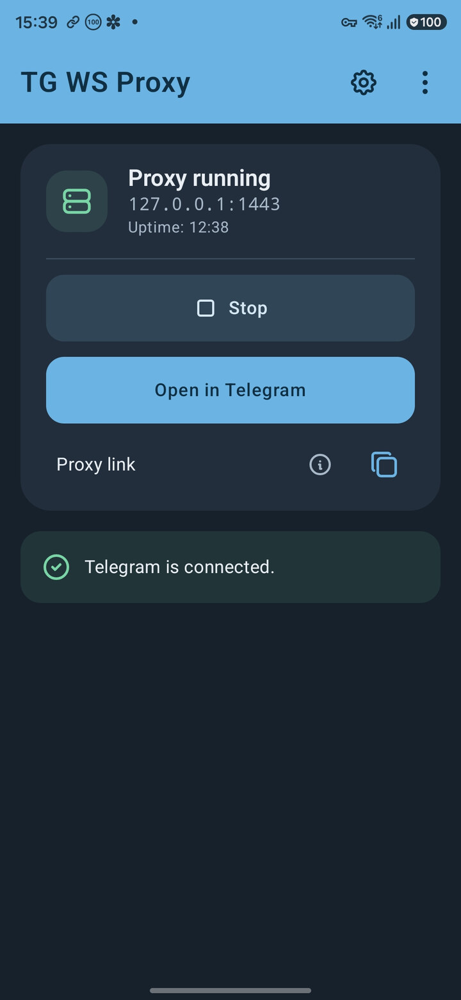
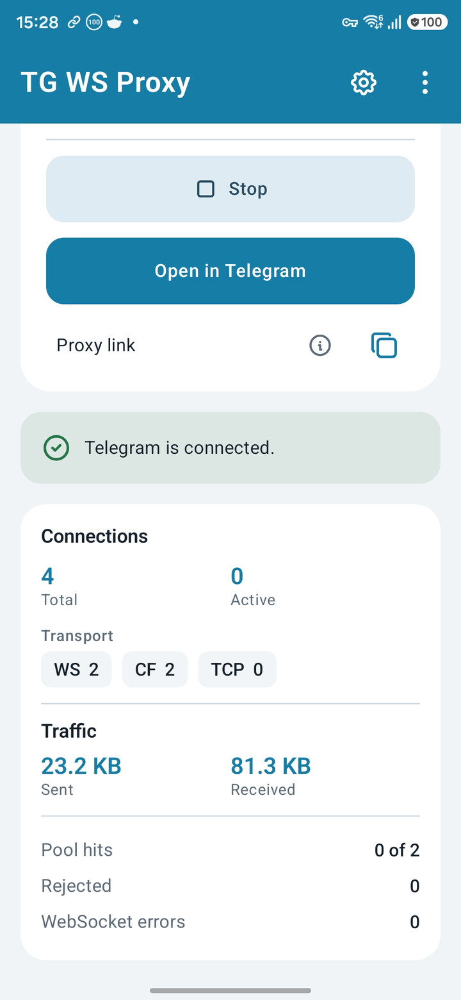
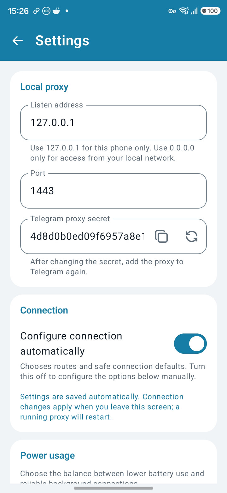
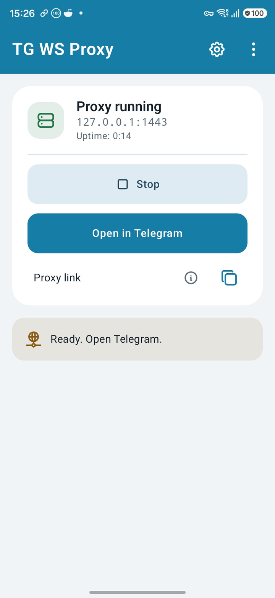
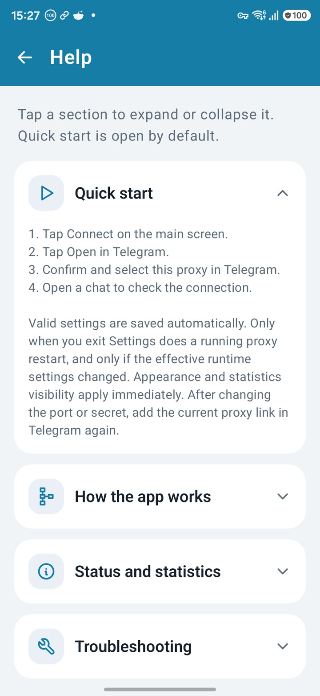
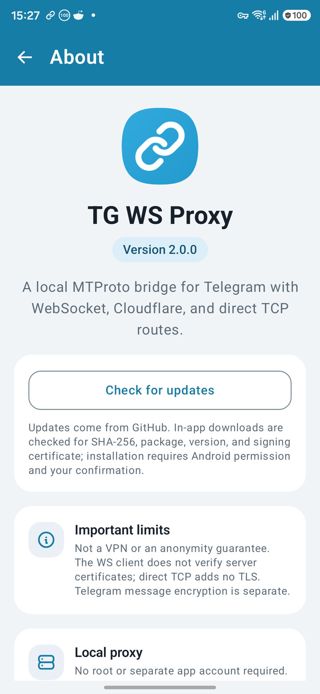

<p align="center">
  <a href="https://github.com/crim50n/tg-ws-proxy-android/releases/latest"></a>
  
  <a href="LICENSE"></a>
</p>

<p align="center"><strong>English</strong> &nbsp; / &nbsp; <a href="README.ru.md">Русский</a></p>

<p align="center">
  
</p>

<h1 align="center">TG WS Proxy</h1>

<p align="center">
  <strong>A local bridge to Telegram, right on your Android.</strong><br>
  MTProto over WebSocket, with Cloudflare and direct TCP fallback.<br>
  No root. No separate server to deploy. No ads or analytics.
</p>

<p align="center">
  <a href="https://github.com/crim50n/tg-ws-proxy-android/releases/latest"></a>
  <a href="#quick-start"></a>
  <a href="release-notes/"></a>
</p>

## Simple to Use. Flexible When Needed.

- **Adaptive routing.** Automatic route selection, with manual WebSocket, Cloudflare,
  and TCP controls when you need them.
- **Quiet defaults.** Extra route checks, prepared connections, and CPU wake lock
  are off by default. Background controls remain available.
- **Clear status.** Local service and Telegram connectivity are shown separately,
  alongside optional traffic statistics and diagnostic logs.
- **Native Android interface.** Notification controls, a Quick Settings tile,
  light and dark themes, Material You, and English / Russian localization.

## Screenshots

<table>
  <tr>
    <th width="33%">Connect</th>
    <th width="33%">Monitor</th>
    <th width="33%">Configure</th>
  </tr>
  <tr>
    <td valign="top"><a href="screenshots/2.0.0/main-dark.jpg"></a></td>
    <td valign="top"><a href="screenshots/2.0.0/statistics.jpg"></a></td>
    <td valign="top"><a href="screenshots/2.0.0/settings.jpg"></a></td>
  </tr>
</table>

<details>
  <summary>Light theme, Help, and About</summary>
  <br>
  <p align="center">
    <a href="screenshots/2.0.0/main.jpg"></a>
    &nbsp;
    <a href="screenshots/2.0.0/help.jpg"></a>
    &nbsp;
    <a href="screenshots/2.0.0/about.jpg"></a>
  </p>
</details>

## Quick Start

1. [Install the latest APK](https://github.com/crim50n/tg-ws-proxy-android/releases/latest)
   on Android 8.0 or newer.
2. Open the app and tap **Connect**.
3. Tap **Open in Telegram**, then confirm and select the proxy.
4. Open a chat to check the connection.

The default listener is **`127.0.0.1:1443`**, accessible only on this device.
Settings save automatically; changed runtime settings take effect when you leave
Settings, restarting an active proxy if needed.

**Your last choice is remembered.** An enabled proxy attempts to resume after
device boot. Stopping it from the app, notification, or Quick Settings keeps it
off. Android force-stop and battery restrictions can prevent background startup.

## Updates and Support

Check for updates in **About**. In-app downloads are verified against the
published SHA-256 checksum, package identity, version, and installed signing
certificate before Android asks you to confirm installation.

For connection problems, start with the built-in **Help**. If the problem persists,
[open an issue](https://github.com/crim50n/tg-ws-proxy-android/issues) with your
Android version, network type, and steps to reproduce. Diagnostic reports are
available under **Settings → Support and diagnostics**; review them before sharing,
even though recognized sensitive data is redacted.

## Security

This is a Telegram proxy, **not a device-wide VPN or an anonymity guarantee**.
It runs locally but connects to remote endpoints. Telegram message encryption is
separate from the proxy transport.

WebSocket TLS certificate verification is intentionally disabled; do not treat
it as an authenticated TLS channel. Direct TCP fallback adds no TLS layer.
Keep the default local address unless you intend to share access: `0.0.0.0`
listens on all IPv4 interfaces. Keep your proxy link and secret private.

## Development

<details>
<summary>Build from source</summary>

Use JDK 17 and the checked-in Gradle wrapper:

```bash
./gradlew :app:testDebugUnitTest :app:lintDebug
./gradlew :app:assembleDebug
./gradlew :app:assembleRelease
```

APKs are written to `app/build/outputs/apk/debug/` and
`app/build/outputs/apk/release/`. Debug builds install separately as
`dev.minios.tgwsproxy.debug`.

Release signing requires the ignored `app/keystore/signing.properties` and its
keystore. Never commit signing files.

</details>

## Credits

Maintained by [crim50n](https://github.com/crim50n). Inspired by
[Flowseal/tg-ws-proxy](https://github.com/Flowseal/tg-ws-proxy), developed
independently. Not an official Telegram product.

Icons by [Tabler](https://github.com/tabler/tabler-icons), Paweł Kuna and
contributors ([MIT](app/src/main/assets/licenses/tabler-icons.txt)).
Project licensed under [MIT](LICENSE).
